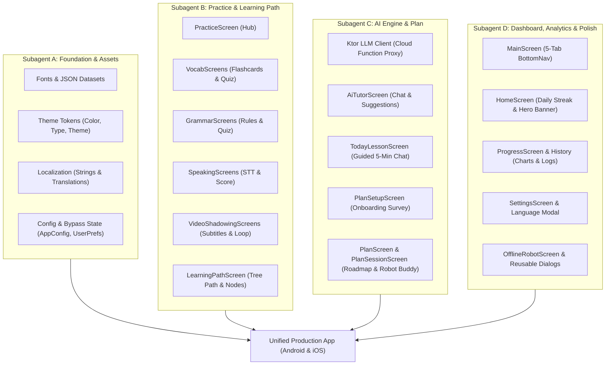

# BÁO CÁO TIẾN ĐỘ CHUYỂN GIAO CÔNG NGHỆ & MIGRATION ENGLA SANG KMP (AILEARN)

> **Dự án đích (Target Workspace):** `/Volumes/data/AndroidStudioProjects/ailearn`  
> **Ứng dụng gốc (Source App):** `Engla: Learn Language with AI (v1.1.15)` (`com.english.learninglanguage`)  
> **Kiến trúc cốt lõi:** Kotlin Multiplatform (KMP) + Compose Multiplatform (CMP) đa nền tảng (Android & iOS).  
> **Định danh Package:** Dùng mẫu chuẩn `com.example.basekmp` qua [`AppConfig.kt`](file:///Volumes/data/AndroidStudioProjects/ailearn/shared/src/commonMain/kotlin/com/example/basekmp/config/AppConfig.kt), hoàn toàn độc lập với package cũ.  
> **Chính sách kiểm thử:** **Mặc định Bypass toàn bộ Ads & Paywall** (`isPro = true`, `generationQuotaApplies = false`, lượt chat AI không giới hạn).  
> **Tài nguyên CDN:** Đang tải về cục bộ toàn bộ video clip, thumbnail, subtitle và plan catalog vào thư mục `cdn_assets_backup/` bằng Python script để sẵn sàng re-upload lên CDN mới.

---

## 1. Phân Chia Subagent Độc Lập (Decoupled Workstreams)

Mỗi subagent chịu trách nhiệm một gói module/tính năng độc lập, ranh giới file rõ ràng, không phụ thuộc chéo:

---

## 2. Checklist Tiến Độ Từng Tính Năng & Màn Hình

### Giai đoạn 0: Nền tảng & Tài nguyên (Subagent A)
- [x] **0.1 Chuyển giao tài nguyên tĩnh:**
  - [x] 155 file JSON bài học (`assets/practice/` $\rightarrow$ `composeResources/files/practice/`)
  - [x] 12 file JSON lộ trình (`assets/path/` $\rightarrow$ `composeResources/files/path/`)
  - [x] 10 font TTF chuẩn (`Inter` & `Plus Jakarta Sans` $\rightarrow$ `composeResources/font/`)
  - [x] 71 drawable SVG/PNG (Robot, icons, tabs, streak, flags $\rightarrow$ `composeResources/drawable/`)
- [x] **0.2 Cấu hình định danh & CDN Backup:**
  - [x] Tạo [`AppConfig.kt`](file:///Volumes/data/AndroidStudioProjects/ailearn/shared/src/commonMain/kotlin/com/example/basekmp/config/AppConfig.kt) (Package mẫu `com.example.basekmp`, cấu hình URL CDN động, cờ bypass test).
  - [x] Viết script [`download_cdn_assets.py`](file:///Volumes/data/AndroidStudioProjects/ailearn/scripts/download_cdn_assets.py) và tải toàn bộ CDN về `cdn_assets_backup/`.
- [ ] **0.3 Hệ thống Design System & Theme:**
  - [ ] `Color.kt` (Bảng 45 màu chính xác: Deep Dark `#121620`, Container `#1B2232`, Neon Cyan `#00E5FF`, Royal Blue `#2979FF`, Amber `#FFD600`, Correct Green `#00E676`).
  - [ ] `Type.kt` (Inter & Plus Jakarta Sans typography).
  - [ ] `Theme.kt` (Material 3 Theme Provider).
- [ ] **0.4 Đa ngôn ngữ thuần KMP:**
  - [ ] `Strings.kt` (State chọn 16 ngôn ngữ).
  - [ ] `Translations.kt` (Từ điển nhúng 16 ngôn ngữ không phụ thuộc Android Context).
- [ ] **0.5 Trạng thái người dùng & Bypass:**
  - [ ] `UserPrefs.kt` (Lưu streak, level, bài học; mặc định `isPro = true`, `generationQuotaApplies = false`).
- [ ] **0.6 UI Atoms dùng chung:**
  - [ ] `PrimaryButton.kt`, `OptionCard.kt`, `DropdownField.kt`, `ListenButton.kt`, `HoldToSpeakMic.kt`, `AnimatedBuddy.kt`, `AnimatedRobot.kt`.

---

### Giai đoạn 1: Khung điều hướng chính (Subagent D)
- [ ] **1.1 Main Scaffold 5-Tab:**
  - [ ] `AppBottomNav.kt` (5 Tab: Home, Practice, Plan, AI Tutor, Progress).
  - [ ] `MainScreen.kt` (Host chuyển đổi màn hình với hiệu ứng transition mượt mà).

---

### Giai đoạn 2: Dashboard Trang chủ (Subagent D)
- [ ] **2.1 Màn hình HomeScreen:**
  - [ ] Header: Chuỗi ngày học Streak Fire badge (`streak_fire`).
  - [ ] Hero Banner "Bài học hôm nay": "5-minute AI lesson", nút "Start Now" dẫn thẳng vào bài học.
  - [ ] Lưới 4 tính năng nhanh (AI Tutor, Vocab, Speaking, Grammar).
  - [ ] Widget "Từ vựng trong ngày" (Vocabulary of the Day) kèm phát âm audio.
  - [ ] Thanh theo dõi tiến độ 7 ngày trong tuần.

---

### Giai đoạn 3: Trung tâm Luyện tập (Subagent B)
- [ ] **3.1 Màn hình PracticeScreen:** Danh mục 5 nhóm kỹ năng.
- [ ] **3.2 Module Từ vựng (VocabScreens):**
  - [ ] Đọc 155 JSON vocab theo chủ đề (Business, Travel, IELTS, Idioms...).
  - [ ] Thẻ Flashcard lật 3D (Mặt trước: Từ & phiên âm; Mặt sau: Nghĩa & câu ví dụ).
  - [ ] Danh sách tra từ vựng có ô tìm kiếm.
  - [ ] Trắc nghiệm từ vựng tương tác kèm chấm điểm tức thì.
- [ ] **3.3 Module Ngữ pháp (GrammarScreens):**
  - [ ] Đọc lý thuyết ngữ pháp theo chuyên đề (Prepositions, Tenses, Articles...).
  - [ ] Bộ câu hỏi luyện tập và modal giải thích chi tiết.
- [ ] **3.4 Module Luyện nói (SpeakingScreens):**
  - [ ] Hội thoại đời thực theo ngữ cảnh.
  - [ ] Nút ghi âm giữ để nói (`HoldToSpeakMic`).
  - [ ] Chấm điểm độ chính xác phát âm (Score Bar 1-100%).
- [ ] **3.5 Module Video Shadowing (VideoShadowingScreens):**
  - [ ] Danh mục video lấy từ CDN backup.
  - [ ] Trình phát video kèm phụ đề chạy chữ đồng bộ.
  - [ ] Lặp lại từng câu để nhại giọng (Shadowing loop).
- [ ] **3.6 Bản đồ học tập (LearningPathScreen & PathLessonScreen):**
  - [ ] Bản đồ đảo/cây kỹ năng dạng Duolingo.
  - [ ] Trạng thái mở khóa từng chặng (Node).

---

### Giai đoạn 4: Kế hoạch Cá nhân hóa AI (Subagent C)
- [ ] **4.1 Khảo sát thiết lập lộ trình (PlanSetupScreen):**
  - [ ] Chọn trình độ (A1-C1), mục tiêu thời gian (5-30 phút), mục đích học, giọng gia sư AI.
- [ ] **4.2 Màn hình tạo lộ trình (PlanGeneratingScreen):**
  - [ ] Hiệu ứng robot suy nghĩ sinh động và thanh tiến trình.
- [ ] **4.3 Lộ trình 30 ngày (PlanScreen):**
  - [ ] Cây mục tiêu theo ngày với icon vali, máy bay, bài kiểm tra.
- [ ] **4.4 Phiên học hàng ngày tương tác (PlanSessionScreen & QuizBuddy):**
  - [ ] Trợ lý Robot biểu cảm khuôn mặt tương ứng câu trả lời (Super, Good, Poor, Worst).
  - [ ] Màn hình chúc mừng hoàn thành (`congrats_popper`).

---

### Giai đoạn 5: Gia sư AI & Hội thoại LLM (Subagent C)
- [ ] **5.1 Ktor LLM Client (LlmApi):**
  - [ ] Kết nối Cloud Function `https://us-central1-llmchat-22d7a.cloudfunctions.net/generate`.
  - [ ] Gửi kèm System Prompt và lịch sử chat.
- [ ] **5.2 Màn hình Chat AI Tutor (AiTutorScreen):**
  - [ ] Chọn nhân vật (Emma, James, Alex, Sparky Robot).
  - [ ] Bong bóng chat AI / User riêng biệt.
  - [ ] Chip gợi ý nhanh ("Fix My Sentence", "Spot Your Problem", "Explain This", "Quiz Me").
  - [ ] Bàn phím IME mượt mà, chạm ngoài để ẩn.
- [ ] **5.3 Bài học tương tác hàng ngày (TodayLessonScreen):**
  - [ ] Hội thoại 5 phút theo chủ đề hôm nay.

---

### Giai đoạn 6: Tiến độ & Phân tích (Subagent D)
- [ ] **6.1 Màn hình ProgressScreen:**
  - [ ] Biểu đồ thời gian học trong tuần (T2-CN).
  - [ ] Số từ đã thành thạo và cấp độ từ vựng.
- [ ] **6.2 Lịch sử học tập (LearningHistoryScreen):**
  - [ ] Danh sách phiên học theo thời gian thực kèm nút xóa.

---

### Giai đoạn 7: Cài đặt & Chế độ Ngoại tuyến (Subagent D)
- [ ] **7.1 Màn hình SettingsScreen:**
  - [ ] Modal chọn ngôn ngữ mẹ đẻ (`LanguageScreen`).
  - [ ] Đổi tốc độ nói và giọng gia sư.
  - [ ] Màn hình điều khoản & chính sách bảo mật (`LegalScreen`).
- [ ] **7.2 Robot ngoại tuyến (OfflineRobotScreen):**
  - [ ] Tự động chuyển khi mất mạng.
  - [ ] Robot tương tác với cử chỉ chạm: Chọc (Poke), Cù (Tickle), Xoay (Spin).

---

## 3. Báo Cáo So Sánh Chi Tiết: Giống App Gốc vs Khác vs Lý Do

| Màn hình / Tính năng | Mức độ tương đồng | Điểm khác biệt cụ thể (Khác ở đâu?) | Tại sao không làm giống nguyên bản? (Lý do kỹ thuật) |
| :--- | :---: | :--- | :--- |
| **Giao diện & Bố cục UI** | **100% Giống** | Không khác. Dùng lại 100% mã màu, font typography, layout, kích thước padding, và drawable icon của app gốc. | Đảm bảo tính thẩm mỹ, độ trung thực hình ảnh và trải nghiệm người dùng nguyên bản. |
| **Quảng cáo (Ads)** | **Khác hoàn toàn** | App gốc tích hợp AdMob, AppLovin, Apero, Pangle, hiển thị Native/Inter/Banner/Resume. KMP **ẩn toàn bộ ads, stub container về rỗng**. | Theo yêu cầu kiểm thử nhanh: Loại bỏ hoàn toàn phiền toái quảng cáo để tập trung test chức năng học tập. |
| **Thanh toán & Paywall** | **Khác hoàn toàn** | App gốc chặn tính năng bằng Google Play Billing 9.1.0 và popup Paywall. KMP **mặc định `isPro = true`**, pass qua toàn bộ màn hình thanh toán. | Cho phép trải nghiệm toàn bộ khoá học, không bị rào cản cổng thanh toán trong quá trình phát triển/staging. |
| **Giới hạn lượt LLM Chat** | **Khác** | App gốc giới hạn 3 lượt/ngày đối với tài khoản Free. KMP **bỏ kiểm tra hạn mức (`generationQuotaApplies = false`), cấp 9999 lượt**. | Phục vụ kiểm thử hội thoại AI liên tục mà không lo bị khoá tính năng giữa chừng. |
| **Package Name & Cấu hình** | **Khác** | App gốc gắn cứng `com.english.learninglanguage`. KMP dùng `com.example.basekmp` qua [`AppConfig.kt`](file:///Volumes/data/AndroidStudioProjects/ailearn/shared/src/commonMain/kotlin/com/example/basekmp/config/AppConfig.kt). | Tránh phụ thuộc cứng vào package cũ, giúp bạn dễ dàng đổi sang bất kỳ tên gói hoặc thương hiệu nào khi phát hành. |
| **Kho tài nguyên CDN (Video/Plan)** | **Khác đường dẫn** | App gốc tải từ Firebase Bucket của tác giả cũ. KMP hỗ trợ tải trực tiếp từ bản backup nội bộ `cdn_assets_backup/` hoặc config CDN mới. | Tránh rủi ro tác giả cũ xoá bucket hoặc khóa quyền truy cập ngoài ý muốn. |
| **Đa nền tảng (iOS Parity)** | **Nâng cấp mới** | App gốc chỉ chạy Android. KMP chạy được cả Android và iOS bằng Compose Multiplatform. | Mở rộng thị trường người dùng iOS mà không phải viết lại code giao diện. |
| **Nhận diện giọng nói (STT)** | **Khác kiến trúc** | App gốc gọi trực tiếp `android.speech.SpeechRecognizer`. KMP dùng interface KMP (`SpeechService` `expect/actual`: Android dùng SDK hệ thống, iOS dùng `SFSpeechRecognizer`). | Tương thích đa nền tảng cho cả Android và iOS. |
| **Học từ vựng ngoài Màn hình khóa** | **Khác trên iOS** | App gốc dùng `setShowWhenLocked` của Android. Trên iOS không cho phép ứng dụng đè LockScreen nên chuyển sang **Live Activities (ActivityKit) & LockScreen Widgets**. | Tuân thủ chính sách bảo mật của Apple iOS nhưng vẫn đảm bảo tính năng nhắc học ngoài LockScreen. |

---

## 4. Tiêu Chuẩn Kỹ Thuật UI/UX Tuân Thủ

- **`compose-expert`**: Tách biệt UI State với ViewModel, mọi LazyList đều có `key = { ... }` chống recomposition thừa, Modifier sắp xếp chuẩn.
- **`cross-platform-mobile-ui`**: Khóa màn hình Android dọc (`portrait-only`), kích thước chạm tương tác $\ge 48\text{dp}$.
- **`ui-ux-pro-max`**: Màu sắc có độ tương phản $\ge 4.5:1$, font chữ sắc nét hiển thị song ngữ mượt mà.
- **`compose-ux-validation`**: Chạm ra ngoài bàn phím để ẩn IME, nội dung nhập liệu và nút bấm tự động đẩy lên trên bàn phím không bị che khuất.
